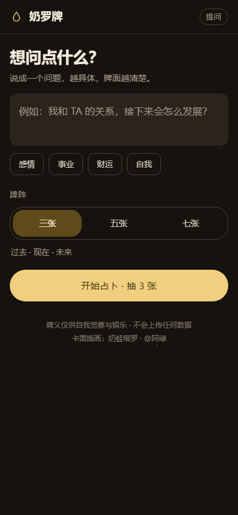
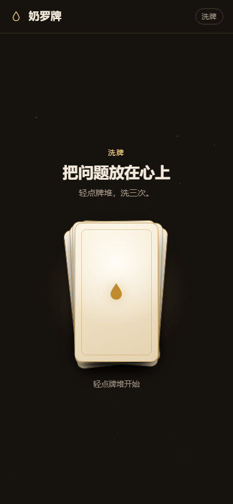
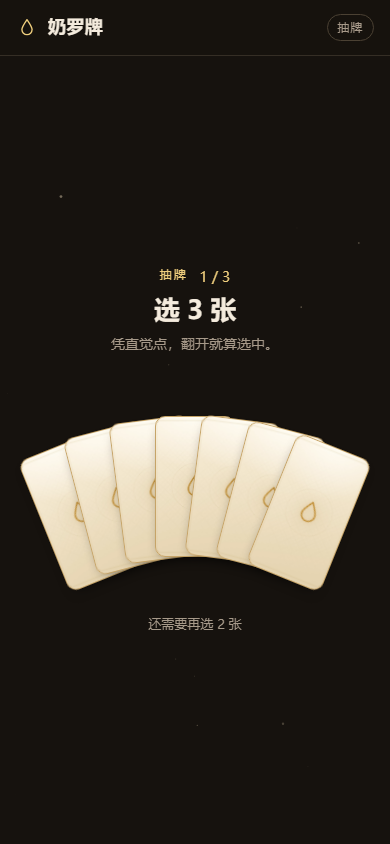
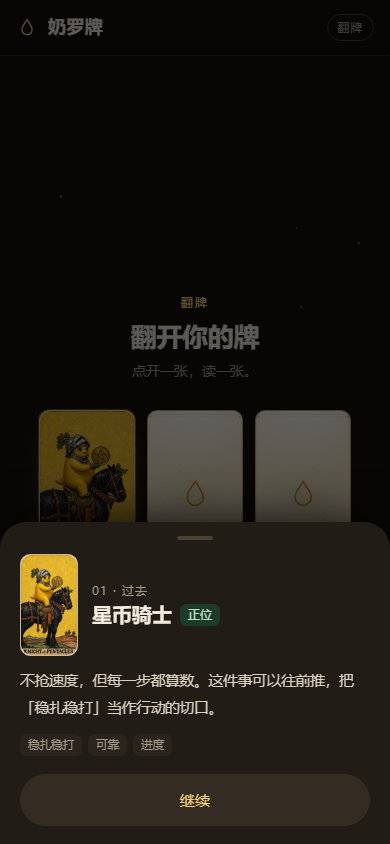
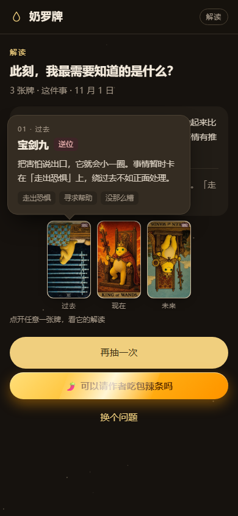
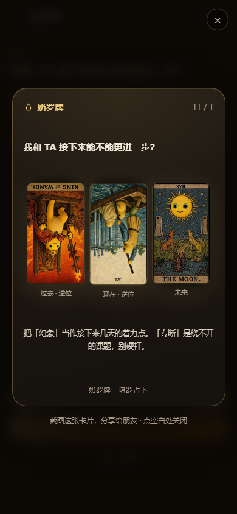

# 奶罗牌 · Tarot of the Veil

> 塔罗占卜：提问 → 洗牌 → 抽牌 → 逐张翻牌看解读 → 整体解读。
> 纯 HTML / CSS / JavaScript，双击 `index.html` 就能用，不联网、不装依赖。

| 提问 | 洗牌 | 抽牌 |
|---|---|---|
|  |  |  |

| 翻牌 · 单张解读 | 解读页 · 点牌看气泡 | 分享图 | 赞赏作者 |
|---|---|---|---|
|  |  |  |  |

---

## 玩法

1. **提问** —— 写下想问的事（或点「感情 / 事业 / 财运 / 自我」套用示例），选牌阵，点「开始占卜」。
2. **洗牌** —— 轻点牌堆，牌堆会左右错开洗动，约 1.5 秒后自动进入抽牌。
3. **抽牌** —— 牌扇展开，凭直觉点选；抽走的牌会从牌扇里收走，剩下的牌重新排布，凑够自动进入翻牌。
4. **翻牌** —— 点开一张，3D 翻面后**立刻从底部弹出这张牌的解读**：牌位、牌名、正/逆位、牌义、关键词。
   关掉弹层再看下一张；已经翻开的牌可以再点一次重新看。全部读完后自动进入解读页。
5. **解读** —— 顶部是一句总览与建议，下面是一排**小牌框**；点任意一个牌框，**气泡**里弹出这张牌的完整解读。

### 解读页不滚动

解读页按一屏设计：标题最多两行、总览压缩到 3～4 行、牌做成 68～72px 的小框，
三张一行、五张一行、七张两行（4 + 3），整页高度控制在手机视口内，不需要下拉。

### 牌阵

| 牌阵 | 位置 |
|---|---|
| 三张 | 过去 · 现在 · 未来 |
| 五张 | 核心 · 阻碍 · 建议 · 趋势 · 提醒 |
| 七张 | 过去 · 现在 · 未来 · 你的状态 · 环境 · 隐藏因素 · 建议 |

逆位概率 30%，逆位牌的插画会倒转并标出「逆位」。

### 按钮很少

| 界面 | 按钮 |
|---|---|
| 提问 | 开始占卜 |
| 洗牌 / 抽牌 | **没有按钮**，点牌堆、点牌就推进 |
| 翻牌 | 弹层里的「继续」 |
| 解读 | 📷 分享牌面 · 再抽一次（回提问页，问题保留）· 🌶️ 请作者吃辣条 · 换个问题（回提问页并清空）|

没有：全部翻开、复制解读、重新洗牌、音效、牌义图鉴、占卜记录、关于页。

---

## 运行

双击 `index.html` 即可。项目没有用 ES Module 或 fetch，`file://` 下也能完整运行。

想用本地服务（可选）：

```bash
python -m http.server 8080
# 打开 http://localhost:8080
```

---

## 文件结构

```
Tarot/
├── index.html          # 提问 / 洗牌 / 抽牌 / 翻牌 / 解读 + 牌义弹层与气泡
├── css/style.css       # 暖奶油色调界面 + 星空、洗牌、牌扇、3D 翻牌、弹层、气泡
├── js/
│   ├── cards.js        # 78 张韦特塔罗：中英文名、元素、正逆位关键词与牌义
│   └── app.js          # 阶段推进、牌扇排布、翻牌弹层、气泡、解读生成
├── assets/cards_nai/   # 当前使用的 78 张奶蛙整卡面（中文文件名）
├── assets/cards/       # 备用：26 张透明插画 + 牌背
├── assets/sponsor-qr.jpg  # 赞赏码（微信收款）
└── screenshots/
```

---

## 卡面

现在用的是 `assets/cards_nai/` 里的 **78 张奶蛙整卡面**（来源与命名规则见该目录的 `清单.md`），
文件名就是中文牌名，代码只负责牌背、翻牌动画和尺寸适配。

```
assets/cards_nai/
├── 愚者.webp … 世界.webp            22 张大阿卡纳
├── 权杖王牌.webp … 权杖国王.webp     14 张权杖
├── 圣杯王牌.webp … 圣杯国王.webp     14 张圣杯
├── 宝剑王牌.webp … 宝剑国王.webp     14 张宝剑
├── 星币王牌.webp … 星币国王.webp     14 张星币
├── 权杖王后-典藏版.webp              彩蛋，不参与抽牌
└── 权杖.webp / 圣杯.webp / …         早前的符号占位图，可删
```

- **换图**：同名覆盖即可。整张卡面（自带边框和牌名），比例约 **0.566**，
  CSS 里用 `--card-ratio: 0.5665` 统一控制卡片外形；换比例不同的图就改这一个变量
- **逆位**：整张图片旋转 180°（牌名会跟着倒），另外叠一个「逆位」角标
- **缺图不会坏**：`onerror` 会把图片移除，自动回落到代码画的米黄牌框 + SVG 线稿
- **牌背**：仍然用 `assets/cards/牌背.webp`（紫色月牙）

### 想换回「代码画框 + 插画」模式

`assets/cards/` 里还留着那套 26 张透明插画（22 大阿卡纳 + 4 个花色）和牌背。
把 `cardEl()` 里的整图 `` 去掉，
改成在 `.art` 层放 `.webp">`
（`<key>`：大阿卡纳用牌名，小阿卡纳用花色名 `权杖/圣杯/宝剑/星币`），
再把 `.tcard-front` 的 padding 和 `.num/.name` 显示出来即可。

---

## 特效与交互

- **星空**：`<canvas>` 手绘星点 + 正弦闪烁，`prefers-reduced-motion` 下自动降级。
- **洗牌**：6 层牌堆用 `animation-delay` 错开的 `translate + rotate` 关键帧，配合光环呼吸。
- **牌扇**：JS 按牌数与容器宽度计算每张牌的 `x / y / 旋转角`（含最外侧牌的包围盒），抽走一张后其余牌顺滑合拢。
- **翻牌**：`preserve-3d` + `backface-visibility`，0.62s 缓动，翻开瞬间有亮度脉冲和投影。
- **单张解读弹层**：Material 底部弹层，上滑 + 遮罩淡入；点「继续」/ 遮罩 / `Esc` 关闭。
- **气泡**：跟着牌框走的小气泡，自动判断向上还是向下展开、左右夹到屏幕内，尾巴对准牌框中心；点外面或 `Esc` 收起。
- **分享图**：结算页点「📷 分享牌面」，弹出竖版分享卡（品牌 + 问题 + 抽到的牌 + 一句建议，逆位牌同样倒转），截图就能发；点空白处或 `Esc` 关。
- **赞赏弹窗**：结算页的「🌶️ 可以请作者吃包辣条吗」，点开是微信收款码；点背景 / ✕ / 「关闭」/ `Esc` 都能收，切走牌局时也会自动收起。
- **反馈**：Material 水波纹、命中时 `navigator.vibrate` 轻震动。

---

## 解读怎么生成

没有接 AI，全是前端规则，同一组牌 + 同一个问题结果稳定（哈希驱动）：

1. **主题识别**：从问题里判断感情 / 事业 / 财运 / 自我 / 其他。
2. **牌义拼接**：牌位语义 + 该牌正位或逆位的牌义 + 一句贴合主题的话（弹层、气泡、总解读共用同一份）。
3. **整体判断**：统计四元素（火 / 水 / 风 / 土）占比与正逆位比例，写成一句总览。
4. **建议**：从正位牌和逆位牌各取一条关键词。
5. **是否问题**：问题含「吗 / 是否 / 该不该 / 要不要」等词时，多给一句倾向判断。

---

## 参考

牌义按公开的韦特（Rider–Waite）体系释义整理重写；交互参考过这些开源项目，代码为重新实现：

- [CodingWithJiro/freecodecamp-js-fortune-teller](https://github.com/CodingWithJiro/freecodecamp-js-fortune-teller)
- [Carring10/tarot-guide](https://github.com/Carring10/tarot-guide)
- [david-marin-0xff/Deckware](https://github.com/david-marin-0xff/Deckware)

---

## 说明

牌义与解读仅供自我觉察与娱乐，不构成医疗、法律、投资等任何专业建议。
所有内容都在本地运行，不会上传任何数据。可自由使用与修改。
